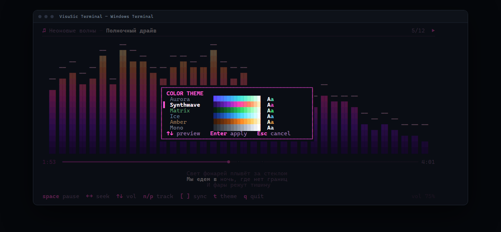
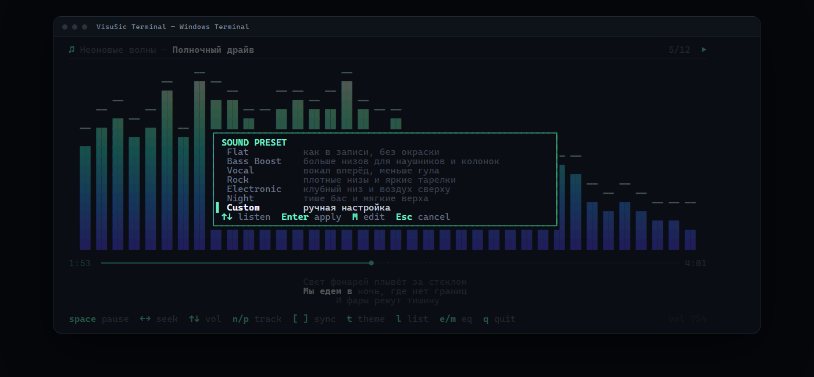
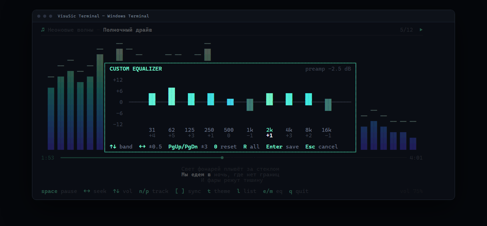
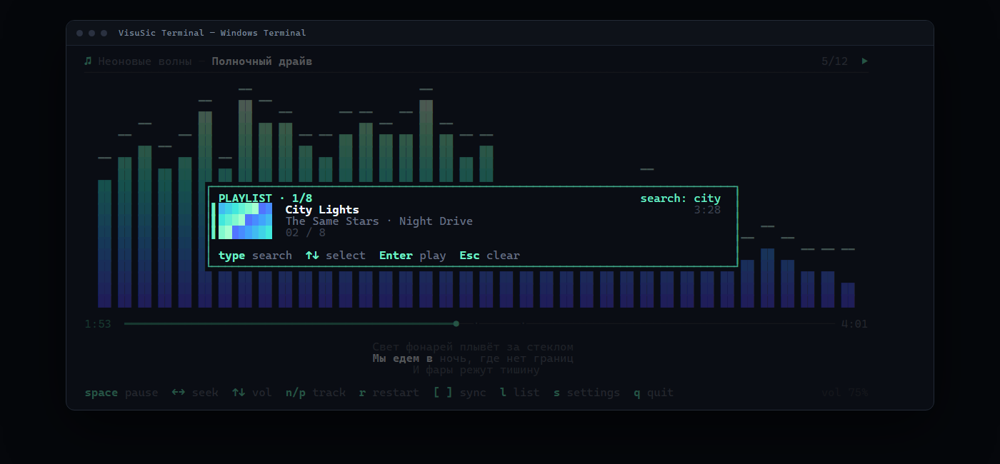

# VisuSic Terminal

[](https://github.com/Donya-12/visusic-terminal/actions/workflows/tests.yml)
[](https://github.com/Donya-12/visusic-terminal/releases)
[](LICENSE)

Лёгкий визуализатор музыки для терминала Windows: караоке-лирика, таймлайн
трека, живой эквалайзер, цветовые темы, плейлист с обложками и Discord-статус.
Один процесс, один экран, без медиатек, плагинов и настроек.

[](https://github.com/Donya-12/visusic-terminal/releases/download/v0.1.0/visusic-promo.mp4)

[▶ Смотреть промо-видео (24 с)](https://github.com/Donya-12/visusic-terminal/releases/download/v0.1.0/visusic-promo.mp4)

## Готовый exe (без Python)

Готовые сборки лежат в [Releases](https://github.com/Donya-12/visusic-terminal/releases):

- `visusic-terminal-win64.zip` — все exe, `README.md`, bat-файлы и картинки;
- `visusic.exe` — только плеер;
- `visusic-fetch.exe` — только загрузчик лирики;
- `visusic-covers.exe` — только загрузчик обложек.

Последняя портативная сборка: [visusic-terminal-win64.zip](https://github.com/Donya-12/visusic-terminal/releases/latest/download/visusic-terminal-win64.zip).

Скачай zip, распакуй в любую папку и запусти `VisuSic.bat`. Если Windows
покажет SmartScreen, жми «Подробнее» → «Выполнить всё равно»: exe без цифровой
подписи.

## Что умеет

- **Караоке-лирика** — читает `.lrc` рядом с треком, плавно закрашивает строку
  по мере пения, поддерживает построчную и пословную (`enhanced LRC`)
  синхронизацию.
- **Таймлайн** — позиция, длительность, метки строк лирики; перемотка стрелками.
- **Эквалайзер** — 10–48 столбцов из FFT, логарифмическая шкала частот,
  сглаживание, пиковые метки. Анализируется тот же буфер, который сейчас
  звучит, поэтому столбцы совпадают с музыкой.
- **Плейлист с обложками** — клавиша `L`: список треков с миниатюрами альбомных
  обложек, выбор и запуск стрелками и `Enter`.
- **Обложки** — встроенные в теги или sidecar-файлы; отдельный
  `fetch-covers.bat` скачивает недостающие с iTunes.
- **Windows media** — система видит трек, исполнителя, альбом и обложку в
  медиа-оверлее, а кнопки клавиатуры/наушников управляют плеером.
- **Discord Rich Presence** — в профиле Discord видно, что играет: трек,
  исполнитель, альбом и таймер. Работает через локальный Discord, без токенов.
- **Звуковой эквалайзер** — настоящий 10-полосный EQ с готовыми пресетами
  (Flat, Bass Boost, Vocal, Rock, Electronic, Night) и ручной настройкой
  полос; Custom сохраняется в конфиге.
- **10 цветовых тем** — от Aurora и Synthwave до Sunset, Cyber и Lavender,
  с живым предпросмотром.
- **Плейлист по папке** — рекурсивный скан, автопереход и повтор; без базы
  данных и импорта.
- **Больше форматов** — mp3, flac, wav, ogg, opus, m4a/m4b, aac, wma, alac,
  ape, wv, mka, aiff; редкие форматы декодирует встроенный FFmpeg.
- **Автопоиск лирики** — отдельный `fetch-lyrics.bat` качает синхронизированные
  `.lrc` с LRCLIB; сам плеер при этом остаётся офлайн.
- **Плеер офлайн** — сеть нужна только `fetch-lyrics.bat` и `fetch-covers.bat`.

## Установка

Нужны Windows 10/11 и Python 3.10+ ([python.org](https://www.python.org/downloads/),
галочка «Add python.exe to PATH»).

1. Распакуй папку проекта.
2. Дважды кликни `install.bat` — он создаст `.venv` и поставит зависимости.
3. Запускай `visusic.bat`, передав папку или файл:

```bat
visusic.bat "C:\Music"
visusic.bat "D:\Music\Artist - Track.mp3" --fps 20 --volume 60
```

Без аргументов сканируется текущая папка, а если в ней нет аудио — системная
`%USERPROFILE%\Music`. Можно перетащить папку мышкой прямо на `visusic.bat`.

Без bat-файлов:

```bat
python -m venv .venv
.venv\Scripts\pip install -e .
.venv\Scripts\python -m visusic "C:\Music"
```

## Управление

| Клавиша | Действие |
| --- | --- |
| `Space` | пауза / продолжить |
| `←` / `→` | −5 / +5 секунд |
| `↑` / `↓` | громкость ±5% |
| `N` / `P` | следующий / предыдущий трек |
| `R` | в начало трека |
| `[` / `]` | сдвинуть лирику на −0.2 / +0.2 с |
| `T` | меню цветовых схем |
| `L` / `Tab` | список треков с обложками |
| `E` | пресеты звукового эквалайзера |
| `M` | ручная настройка эквалайзера |
| `Q` / `Esc` | выход |

В плейлисте: `↑`/`↓` — выбор, `PgUp`/`PgDn` — быстрее, `Home`/`End` —
начало/конец, `Enter` — играть, `Esc` — закрыть.

В меню звука и тем: `↑`/`↓` — переключать, `Enter` — применить и сохранить,
`Esc` — отменить, цифры — быстрый выбор. В меню звука `M` открывает ручной
редактор полос.

Когда лирика отстаёт или спешит, поправь её на слух клавишами `[` и `]`.
Текущий сдвиг показывается в правом нижнем углу (`sync +0.4s`).

## Темы

Нажми `T` — откроется меню с живым предпросмотром. `↑`/`↓` переключают тему
сразу, `Enter` применяет и сохраняет, `Esc` возвращает прежнюю, цифры — быстрый
выбор.



| Пресет | Настроение |
| --- | --- |
| `Aurora` | мятный акцент, фиолетово-бирюзовый спектр — тема по умолчанию |
| `Synthwave` | неон-розовый, фиолетово-оранжевый градиент |
| `Matrix` | зелёный CRT |
| `Ice` | холодный голубой |
| `Amber` | янтарный CRT |
| `Mono` | монохром для минимализма |
| `Sunset` | закатный коралл и золото |
| `Cyber` | кислотный жёлтый и бирюза |
| `Crimson` | глубокий красный и медь |
| `Lavender` | мягкая лаванда |

Выбор сохраняется в `%APPDATA%\visusic-terminal\config.json`. Для разового
запуска без сохранения:

```bat
visusic.bat "C:\Music" --theme synthwave
```

Доступные имена: `aurora`, `synthwave`, `matrix`, `ice`, `amber`, `mono`,
`sunset`, `cyber`, `crimson`, `lavender`.
Темы рассчитаны на тёмный фон терминала (Windows Terminal по умолчанию).

## Звук

`E` открывает пресеты 10-полосного эквалайзера. Переключение слышно сразу:
`↑`/`↓` — слушать, `Enter` — сохранить, `Esc` — отменить.

`M` — ручной редактор для точной настройки:

| Клавиша | Действие |
| --- | --- |
| `↑` / `↓` | выбрать полосу (31 Гц … 16 кГц) |
| `←` / `→` | −0.5 / +0.5 дБ |
| `PgUp` / `PgDn` | +3 / −3 дБ |
| `0` | сбросить полосу в 0 дБ |
| `R` | сбросить все полосы |
| `Enter` | сохранить как `Custom` |
| `Esc` | отменить и вернуть прежний пресет |

Редактор стартует с полос текущего пресета, применяет изменения на слух и
показывает запас по громкости (preamp), чтобы бусты не клипповали. `Custom`
появляется последней строкой в меню `E` и хранится в
`%APPDATA%\visusic-terminal\config.json` (`eq` + `eq_gains`).





| Пресет | Звучание |
| --- | --- |
| `Flat` | как в записи, без окраски |
| `Bass Boost` | больше низов для наушников и колонок |
| `Vocal` | вокал вперёд, меньше гула |
| `Rock` | плотные низы и яркие тарелки |
| `Electronic` | клубный низ и воздух сверху |
| `Night` | тише бас и мягкие верха |
| `Custom` | своя настройка полос, сохраняется автоматически |

Выбор сохраняется рядом с темой. Для разового запуска:

```bat
visusic.bat "C:\Music" --eq bass
visusic.bat "C:\Music" --eq custom
```

Доступные имена: `flat`, `bass`, `vocal`, `rock`, `electronic`, `night`,
`custom`.

## Плейлист и обложки

`L` открывает список треков: миниатюра обложки, название, исполнитель, альбом и
длительность. Обложки берутся из тегов (ID3, FLAC, MP4/M4A, Vorbis) или из
sidecar-файла рядом с аудио: `<трек>.jpg`, `cover.jpg`, `folder.jpg` или
`front.jpg` (поддерживаются JPEG, PNG, WebP). Если обложки нет — рисуется
цветной placeholder в палитре текущей темы.



В медиа-оверлее Windows показывается полноценная обложка из этих же тегов или
sidecar-файла.

### Загрузка обложек (iTunes)

Если обложки нет, её можно скачать:

```bat
fetch-covers.bat "C:\Music"
```

Скрипт ищет трек в iTunes Search API, проверяет исполнителя/название и
длительность, обрезает картинку в квадрат 600×600 и сохраняет
`Artist - Title.jpg` рядом с треком. Встроенные обложки и уже существующие
sidecar-файлы не трогает.

```bat
fetch-covers.bat "C:\Music" --dry-run     :: только показать совпадения
fetch-covers.bat "C:\Music" --limit 10    :: скачать первые 10
fetch-covers.bat "C:\Music" --overwrite   :: заменить sidecar .jpg
```

После скачивания перезапусти трек (`N`/`P`) или плеер: обложки кешируются при
загрузке.

## Windows media

Плеер публикует обычную медиа-сессию Windows (SMTC): в оверлее на клавише
громкости и на экране блокировки видны название, исполнитель, альбом, обложка и
таймлайн. Кнопки play/pause, следующий/предыдущий трек и перемотка с клавиатуры,
наушников или из оверлея управляют VisuSic.

Для этого используются WinRT-компоненты Windows; они ставятся вместе с
зависимостями и входят в exe. Само воспроизведение по-прежнему идёт через
WASAPI/sounddevice, а системная медиа-сессия — через беззвучный служебный
источник.

## Discord

Rich Presence включён по умолчанию: в профиле Discord видно, что вы слушаете —
название трека, исполнителя, альбом и таймер. Используется встроенное приложение
«VisuSic Terminal» и локальный Discord IPC; никаких токенов и аккаунтов не нужно.
Достаточно запущенного Discord для Windows.

Статус обновляется при смене трека, паузе и перемотке. Если Discord закрыт,
клиент повторяет подключение сам.

```bat
visusic.bat "C:\Music" --no-discord          :: выключить статус
visusic.bat "C:\Music" --discord-id 123...   :: свой Discord Application ID
```

Свой Application ID можно создать на
[Discord Developer Portal](https://discord.com/developers/applications); ID
сохраняется в конфиге.

## Лирика

Положи `.lrc` с тем же именем, что и аудиофайл:

```
Music/
  Artist - Title.mp3
  Artist - Title.lrc
```

Минимальный LRC:

```lrc
[ar:Artist]
[ti:Title]
[00:12.40]First line
[00:17.20]Second line
```

Поддерживается:

- несколько таймкодов на одной строке: `[00:12.40][01:05.00]Chorus`;
- глобальный сдвиг `[offset:+250]` (в миллисекундах);
- пословная синхронизация:

```lrc
[00:12.00]<00:12.00>Hello <00:12.45>big <00:12.90>world
```

- кодировки UTF-8 (с BOM и без), UTF-16 и CP1251 — русские LRC читаются
  автоматически.

Нет `.lrc` — трек всё равно играет, просто без лирики. Lyric-файл ищется рядом
с аудио, регистр расширения и имени не важен.

### Автопоиск лирики (LRCLIB)

Если `.lrc` нет, их можно скачать пачкой:

```bat
fetch-lyrics.bat "C:\Music"
```

Скрипт берёт исполнителя и название из имени файла, ищет синхронизированный
текст на [LRCLIB](https://lrclib.net) и сохраняет `Artist - Title.lrc` рядом с
треком. Уже существующие `.lrc` не трогает.

Полезные флаги:

```bat
fetch-lyrics.bat "C:\Music" --dry-run          :: только показать совпадения
fetch-lyrics.bat "C:\Music" --limit 10         :: скачать первые 10
fetch-lyrics.bat "C:\Music" --overwrite        :: перезаписать старые .lrc
```

Важно: это единственная часть, которая ходит в сеть, и только когда её
запускают руками. Сам плеер остаётся офлайн. Для каверов, live-версий и
редких треков совпадения может не быть — тогда `.lrc` нужен вручную.

## Форматы

`mp3`, `flac`, `wav`, `ogg`, `oga`, `opus`, `aiff`, `m4a`, `m4b`, `aac`,
`wma`, `alac`, `ape`, `wv`, `mka` — основные форматы декодирует libsndfile,
остальные (и проблемные файлы) — встроенный FFmpeg. Видеофайлы (`.mp4`,
`.mkv`) не сканируются: плеер работает только со звуковыми дорожками
музыкальных контейнеров.

Звук выводится через WASAPI с низкой задержкой, при проблемах — через
устройство по умолчанию. Позиция для лирики и спектра компенсирует задержку
вывода, поэтому картинка не убегает вперёд.

## Если что-то не так

- **Нет звука.** Проверь устройство вывода в Windows. Если другое приложение
  заняло устройство в exclusive-режиме, закрой его — визуализатор попробует
  fallback-устройство.
- **Вместо столбиков квадраты.** Терминалу нужен шрифт с блочными символами:
  Cascadia Mono (в Windows Terminal по умолчанию) или Consolas. Запускай в
  Windows Terminal.
- **Терминал замирает после клика.** Это QuickEdit консоли Windows: выделение
  текста останавливает вывод. Нажми `Esc` или не выделяй текст во время игры.
- **Мелко/криво.** Полный layout включается с высоты 14 строк; ниже (8–13
  строк) — компактный режим с мини-эквалайзером и тремя lyric-строками. При
  ширине меньше 24 колонок показывается заглушка.

## Как устроено

| Файл | Назначение |
| --- | --- |
| `visusic/player.py` | декодирование, ресемплинг, WASAPI-поток, позиция |
| `visusic/spectrum.py` | FFT, логарифмические полосы, сглаживание |
| `visusic/equalizer.py` | пресеты, ручные полосы и FIR-фильтр |
| `visusic/metadata.py` | теги, обложки, миниатюры |
| `visusic/smtc.py` | Windows media session (SMTC) |
| `visusic/discord.py` | Discord Rich Presence |
| `visusic/lrc.py` | парсер LRC, прогресс строки и слов |
| `visusic/ui.py` | ANSI-канвас, эквалайзер, таймлайн, караоке, меню |
| `visusic/theme.py` | пресеты палитр, цветовой градиент, config |
| `visusic/app.py` | цикл, клавиши, плейлист, автопереход треков |
| `visusic/library.py` | поиск файлов и разбор имён |
| `visusic/fetch.py` | опциональный поиск `.lrc` на LRCLIB |
| `visusic/covers.py` | опциональный поиск обложек на iTunes |

Тесты (77 штук):

```bat
.venv\Scripts\python -m unittest discover -s tests
```

Макет интерфейса для скриншота: `python tools/preview.py` →
`docs/preview.html`.

Сборка автономных exe (PyInstaller):

```bat
.venv\Scripts\pip install -e .[build]
.venv\Scripts\python tools\build_exe.py
```

Готовые файлы появятся в `dist\visusic.exe` и `dist\visusic-fetch.exe`.

## Лицензия

MIT — см. [LICENSE](LICENSE).
