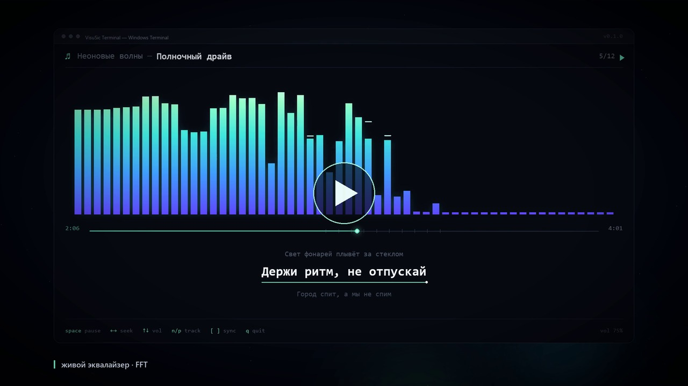

# VisuSic Terminal

[](https://github.com/Donya-12/visusic-terminal/actions/workflows/tests.yml)
[](https://github.com/Donya-12/visusic-terminal/releases)
[](LICENSE)

Лёгкий визуализатор музыки для терминала Windows: караоке-лирика, таймлайн
трека и живой эквалайзер. Один процесс, один экран, без медиатек, плагинов и
настроек.

[](https://github.com/Donya-12/visusic-terminal/releases/download/v0.1.0/visusic-promo.mp4)

[▶ Смотреть промо-видео (24 с)](https://github.com/Donya-12/visusic-terminal/releases/download/v0.1.0/visusic-promo.mp4)

## Готовый exe (без Python)

Готовые сборки лежат в [Releases](https://github.com/Donya-12/visusic-terminal/releases):

- `visusic-terminal-0.1.0-win64.zip` — оба exe, `README.md` и bat-файлы для
  запуска;
- `visusic.exe` — только плеер;
- `visusic-fetch.exe` — только загрузчик лирики.

Скачай zip, распакуй в любую папку и запусти `VisuSic.bat`. Если Windows
покажет SmartScreen, жми «Подробнее» → «Выполнить всё равно»: exe без цифровой
подписи.

## Что умеет

- **Караоке-лирика** — читает `.lrc` рядом с треком, плавно закрашивает строку
  по мере пения, поддерживает построчную и пословную (`enhanced LRC`)
  синхронизацию.
- **Таймлайн** — позиция, длительность, метки строк лирики; перемотка стрелками.
- **Эквалайзер** — 10–48 столбцов из FFT, логарифмическая шкала частот,
  сглаживание, пиковые метки. Анализируется тот же буфер, который сейчас
  звучит, поэтому столбцы совпадают с музыкой.
- **Плейлист** — рекурсивно сканирует папку, играет по кругу, переключает треки
  сам. Никакой базы данных и импорта: просто папка с файлами.
- **Автопоиск лирики** — отдельный `fetch-lyrics.bat` качает синхронизированные
  `.lrc` с LRCLIB; сам плеер при этом остаётся офлайн.
- **Плеер офлайн** — сеть нужна только опциональному `fetch-lyrics.bat`.

## Установка

Нужны Windows 10/11 и Python 3.10+ ([python.org](https://www.python.org/downloads/),
галочка «Add python.exe to PATH»).

1. Распакуй папку проекта.
2. Дважды кликни `install.bat` — он создаст `.venv` и поставит зависимости.
3. Запускай `visusic.bat`, передав папку или файл:

```bat
visusic.bat "C:\Music"
visusic.bat "D:\Music\Artist - Track.mp3" --fps 20 --volume 60
```

Без аргументов сканируется текущая папка, а если в ней нет аудио — системная
`%USERPROFILE%\Music`. Можно перетащить папку мышкой прямо на `visusic.bat`.

Без bat-файлов:

```bat
python -m venv .venv
.venv\Scripts\pip install -e .
.venv\Scripts\python -m visusic "C:\Music"
```

## Управление

| Клавиша | Действие |
| --- | --- |
| `Space` | пауза / продолжить |
| `←` / `→` | −5 / +5 секунд |
| `↑` / `↓` | громкость ±5% |
| `N` / `P` | следующий / предыдущий трек |
| `R` | в начало трека |
| `[` / `]` | сдвинуть лирику на −0.2 / +0.2 с |
| `Q` / `Esc` | выход |

Когда лирика отстаёт или спешит, поправь её на слух клавишами `[` и `]`.
Текущий сдвиг показывается в правом нижнем углу (`sync +0.4s`).

## Лирика

Положи `.lrc` с тем же именем, что и аудиофайл:

```
Music/
  Artist - Title.mp3
  Artist - Title.lrc
```

Минимальный LRC:

```lrc
[ar:Artist]
[ti:Title]
[00:12.40]First line
[00:17.20]Second line
```

Поддерживается:

- несколько таймкодов на одной строке: `[00:12.40][01:05.00]Chorus`;
- глобальный сдвиг `[offset:+250]` (в миллисекундах);
- пословная синхронизация:

```lrc
[00:12.00]<00:12.00>Hello <00:12.45>big <00:12.90>world
```

- кодировки UTF-8 (с BOM и без), UTF-16 и CP1251 — русские LRC читаются
  автоматически.

Нет `.lrc` — трек всё равно играет, просто без лирики. Lyric-файл ищется рядом
с аудио, регистр расширения и имени не важен.

### Автопоиск лирики (LRCLIB)

Если `.lrc` нет, их можно скачать пачкой:

```bat
fetch-lyrics.bat "C:\Music"
```

Скрипт берёт исполнителя и название из имени файла, ищет синхронизированный
текст на [LRCLIB](https://lrclib.net) и сохраняет `Artist - Title.lrc` рядом с
треком. Уже существующие `.lrc` не трогает.

Полезные флаги:

```bat
fetch-lyrics.bat "C:\Music" --dry-run          :: только показать совпадения
fetch-lyrics.bat "C:\Music" --limit 10         :: скачать первые 10
fetch-lyrics.bat "C:\Music" --overwrite        :: перезаписать старые .lrc
```

Важно: это единственная часть, которая ходит в сеть, и только когда её
запускают руками. Сам плеер остаётся офлайн. Для каверов, live-версий и
редких треков совпадения может не быть — тогда `.lrc` нужен вручную.

## Форматы

`mp3`, `flac`, `wav`, `ogg`, `opus`, `aiff` — то, что умеет libsndfile.
`.m4a`/`.aac` и `.wma` не поддерживаются (это ограничение декодера, а не UI).

Звук выводится через WASAPI с низкой задержкой, при проблемах — через
устройство по умолчанию. Позиция для лирики и спектра компенсирует задержку
вывода, поэтому картинка не убегает вперёд.

## Если что-то не так

- **Нет звука.** Проверь устройство вывода в Windows. Если другое приложение
  заняло устройство в exclusive-режиме, закрой его — визуализатор попробует
  fallback-устройство.
- **Вместо столбиков квадраты.** Терминалу нужен шрифт с блочными символами:
  Cascadia Mono (в Windows Terminal по умолчанию) или Consolas. Запускай в
  Windows Terminal.
- **Терминал замирает после клика.** Это QuickEdit консоли Windows: выделение
  текста останавливает вывод. Нажми `Esc` или не выделяй текст во время игры.
- **Мелко/криво.** Полный layout включается с высоты 14 строк; ниже (8–13
  строк) — компактный режим с мини-эквалайзером и тремя lyric-строками. При
  ширине меньше 24 колонок показывается заглушка.

## Как устроено

| Файл | Назначение |
| --- | --- |
| `visusic/player.py` | декодирование, ресемплинг, WASAPI-поток, позиция |
| `visusic/spectrum.py` | FFT, логарифмические полосы, сглаживание |
| `visusic/lrc.py` | парсер LRC, прогресс строки и слов |
| `visusic/ui.py` | ANSI-канвас, эквалайзер, таймлайн, караоке |
| `visusic/app.py` | цикл, клавиши, автопереход треков |
| `visusic/library.py` | поиск файлов и разбор имён |
| `visusic/fetch.py` | опциональный поиск `.lrc` на LRCLIB |

Тесты:

```bat
.venv\Scripts\python -m unittest discover -s tests
```

Макет интерфейса для скриншота: `python tools/preview.py` →
`docs/preview.html`.

Сборка автономных exe (PyInstaller):

```bat
.venv\Scripts\pip install -e .[build]
.venv\Scripts\python tools\build_exe.py
```

Готовые файлы появятся в `dist\visusic.exe` и `dist\visusic-fetch.exe`.

## Лицензия

MIT — см. [LICENSE](LICENSE).
